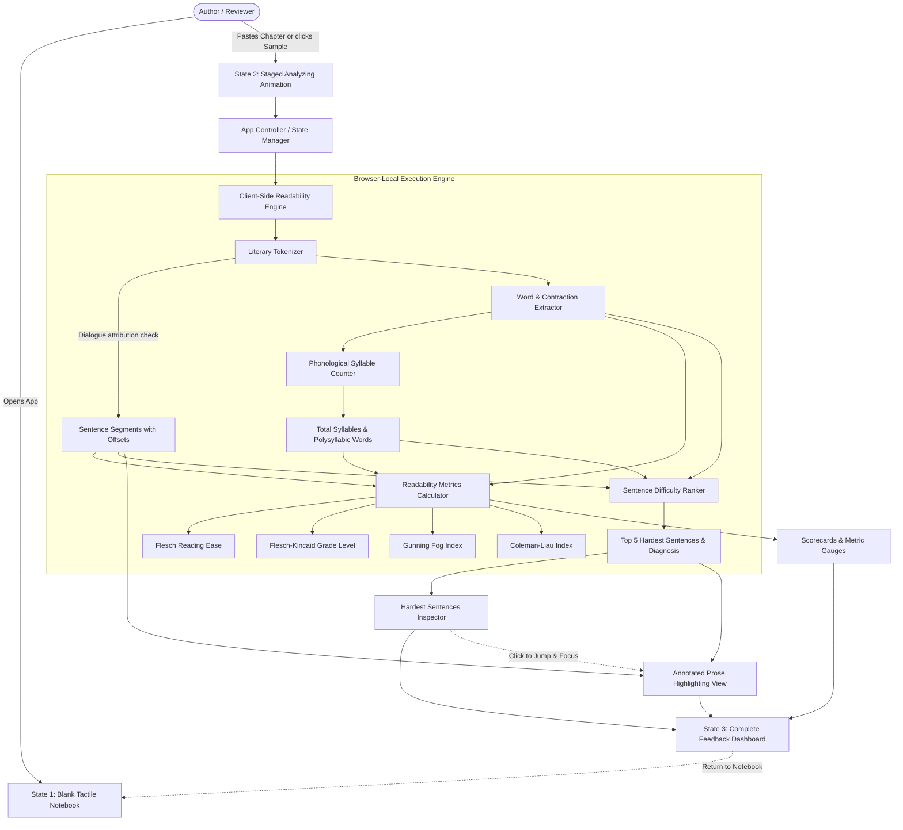

# ARCHITECTURE.md: Chapter Readability Lens

## System Overview

Chapter Readability Lens is an ultra-fast, zero-dependency, client-side web application built with vanilla modern Web Standards (ES Modules, HTML5, CSS3, `Intl` APIs). It operates entirely within the user's browser, guaranteeing data confidentiality and sub-50ms execution times for multi-thousand word book chapters.

## Architectural Diagram

## Data Flow & Processing Pipeline

1. **State 1: Blank Notebook (Input Ingestion)**:
   - On page load, the user interacts with an uncluttered parchment notebook canvas.
   - The user pastes raw chapter text (or selects a benchmark sample).
   - A `paste` event listener immediately detects the input and initiates the analysis workflow.

2. **State 2: Staged Analyzing Animation**:
   - The UI displays a literary scanning beam and multi-phase status updates:
     - 1. Tokenizing literary sentences & preserving dialogue
     - 2. Calculating syllable cadence & Flesch-Kincaid indices
     - 3. Isolating the 5 hardest sentences
   - Gives the user a tangible, satisfying sensation of thorough textual evaluation before rendering.

3. **State 3: Results Dashboard**:
   - Smoothly reveals readability scorecards, annotated manuscript prose with ranked `#1`–`#5` badges, and the hardest sentences inspector.
   - Provides an immediate "← Return to Notebook" button to revise or test another chapter.

4. **Literary Tokenization (`tokenizer.js`)**:
   - Scans text character by character.
   - Guardrails honorific abbreviations (`Dr.`, `Mr.`, `Mrs.`, `Prof.`, `St.`, `vol.`, `ch.`).
   - Dialogue preservation: When punctuation inside a quote (`!"`, `?"`) is followed by lowercase speech attribution (`said`, `whispered`, `he`, `she`), the sentence continues.
   - Extracts exact 0-indexed character offsets `[start, end]` for each sentence to facilitate non-destructive highlight wrapping.

3. **Phonological Syllable Counter (`syllables.js`)**:
   - Applies CMUdict-calibrated rules: silent 'e' deduction, '-le' syllabic exceptions, vowel cluster coalescing, past-tense '-ed' elision, and irregular lookup tables.
   - Flags complex words ($\ge 3$ syllables, excluding proper nouns and simple suffixes).

4. **Metric Formulation (`readability.js`)**:
   - **Flesch Reading Ease**: $206.835 - 1.015 \left(\frac{W}{S}\right) - 84.6 \left(\frac{Y}{W}\right)$
   - **Flesch-Kincaid Grade Level**: $0.39 \left(\frac{W}{S}\right) + 11.8 \left(\frac{Y}{W}\right) - 15.59$
   - **Gunning Fog**: $0.4 \left[\frac{W}{S} + 100 \left(\frac{\text{complex}}{W}\right)\right]$
   - **Coleman-Liau**: $0.0588 L - 0.296 S - 15.8$ (syllable-independent character formula)

5. **Sentence Difficulty Scorer (`sentenceRanker.js`)**:
   - Evaluates each sentence against a composite heuristic combining word count fatigue ($W > 25$), polysyllabic load, and clause punctuation density.
   - Extracts the Top 5 hardest sentences, decorated with ranked badges (`#1` to `#5`) and editorial suggestions.

6. **Interactive Rendering (`app.js` & `styles.css`)**:
   - Renders the full prose into structured paragraphs.
   - Wraps the top 5 sentences in accessible `<mark>` nodes with numbered badges and hover tooltips.
   - Renders the sidebar inspector cards with smooth scroll event listeners (`scrollIntoView({ behavior: 'smooth' })`).

## Technical Stack Decisions

- **Zero Runtime Dependencies**: No heavy frameworks (React/Vue/Angular) or bundled bloated libraries. Instant initial load time (<100ms), 0 kB framework overhead, and runs natively in any browser.
- **Node Test Runner**: Uses native Node.js `node:test` and `node:assert` for clean, sub-second continuous testing.
- **Design System**: Fully grounded in `Ember Studio` design tokens using native CSS custom properties.
- **Deployment Ready**: Standard static distribution deployable to GitHub Pages, Vercel, Netlify, or Cloudflare Pages with zero configuration.
